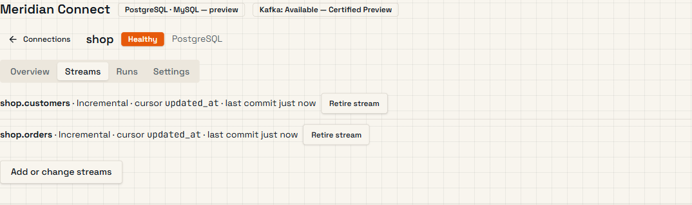
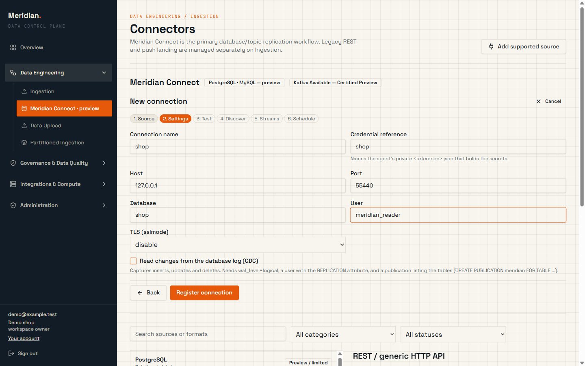
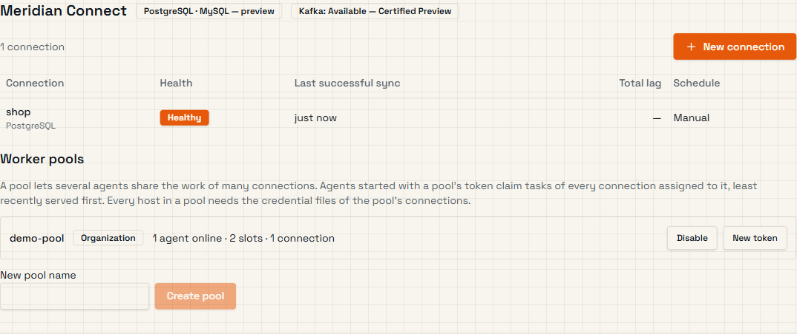
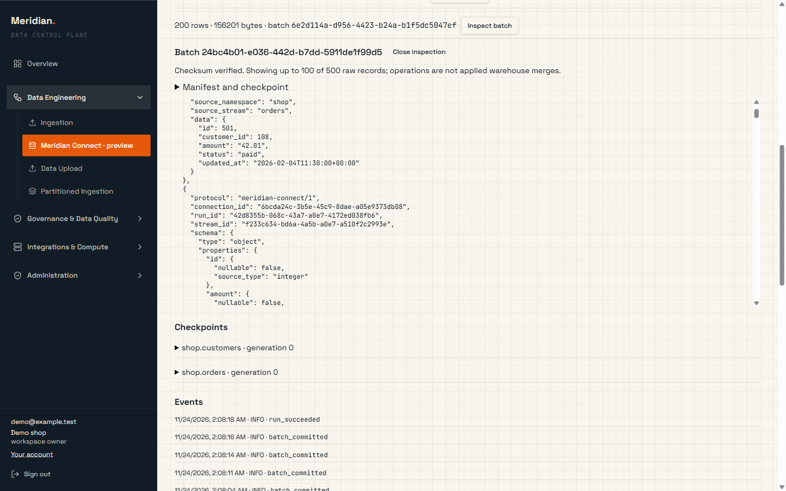

# Meridian Community

Open-source data ingestion with a web control plane. Bring data in from REST APIs, files,
databases and streams, and retain immutable raw ingestion batches and their manifests.

This is preview software. Read the [disclaimer](#meridian-community-preview--disclaimer) before
you point it at data you care about.



## See it

These screenshots come from a local Preview 0.4 installation running the
[demo](#5-minute-quickstart) below. The data is generated sample data.

| Connect wizard                                                                      | Worker pools                                                                              |
| ----------------------------------------------------------------------------------- | ----------------------------------------------------------------------------------------- |
|   |                         |
| You enter only non-secret settings. The password stays in a file on the agent host. | Agents started with a pool token share the work of every connection assigned to the pool. |

**Bronze data.** Each committed batch can be inspected: Meridian verifies its checksum and shows
the raw records, here an order from the sample `shop.orders` table.



## 5-minute quickstart

From install to rows landed in Bronze, using a sample PostgreSQL database that the demo script
starts for you. On our Windows 11 test machine, with Docker images already downloaded, the install
took about 2.5 minutes and steps 2 to 7 about 4. A first install also downloads the images, which
can take 10 minutes or more.

You need Docker (on Docker Desktop, set Settings > Resources > Network > Port binding behavior to
"Localhost by default") and Python 3.10 or later for the demo agent.

**1. Install and start Meridian.**

- Windows 11: download `meridian-<version>-windows.zip` from the
  [latest release](../../releases), extract it, and in that folder run:

  ```powershell
  .\meridian.cmd install
  .\meridian.cmd start
  ```

- macOS or Ubuntu/Debian: download `meridian-<version>-macos.tar.gz` or
  `meridian-<version>-linux.tar.gz`, extract it, and run `./meridian install` then
  `./meridian start`.
- From source, with Node 26, Bun 1.4 and Supabase CLI 2.122:

  ```sh
  node scripts/self-host.mjs install
  node scripts/self-host.mjs start
  ```

Release packages up to Preview 0.4 don't include the demo script yet. Copy
[`scripts/demo.mjs`](scripts/demo.mjs) from this repository into the `scripts` folder of your
installation. If the Windows launcher downloaded Node for you, `.\meridian.cmd status` shows its
path; use that in place of `node` below.

**2. Create an account.** Open http://localhost:8080 and choose **No account? Sign up**. Confirm
the email in the local mail viewer the installer prints (http://localhost:58324 with the default
ports), opening the link in the same browser. Finish the three onboarding steps.

**3. Start the sample database.** In the installation folder run:

```sh
node scripts/demo.mjs source
```

It starts PostgreSQL on 127.0.0.1:55440 with 200 customers and 1,000 orders, creates a login that
cannot change data, writes the agent's credential file to `.meridian/demo/shop.json`, and prints
the values for the next step.

**4. Register the connection.** Go to **Data Engineering > Meridian Connect > New connection**,
choose **PostgreSQL**, then **Continue**. Enter the printed values:

| Field                | Value                                                      |
| -------------------- | ---------------------------------------------------------- |
| Connection name      | `shop`                                                     |
| Credential reference | `shop`                                                     |
| Host                 | `127.0.0.1`                                                |
| Port                 | `55440`                                                    |
| Database             | `shop`                                                     |
| User                 | `meridian_reader`                                          |
| TLS (sslmode)        | `disable` (only because this demo database is on loopback) |

Choose **Register connection**. Copy the agent token it shows; it is shown only once.

**5. Start the agent.** In a second terminal, in the same folder:

```sh
node scripts/demo.mjs agent
```

Paste the token when asked (input is hidden). The first run creates a Python environment for the
agent. Leave it running: it polls Meridian every 10 seconds.

**6. Test, discover and choose streams.** In the wizard choose **Test connection**, then
**Continue**, **Discover streams** (it finds `shop.customers` and `shop.orders`) and
**Continue**. Select both streams, keep cursor `updated_at` and **Incremental (cursor)**, then
**Save and continue** and **Save schedule and finish**.

**7. Land the rows.** Choose **Sync now**. On the **Runs** tab the sync succeeds with 1,200
rows. Under **Committed bronze batches**, choose **Inspect batch** to see the verified records.

**8. Sync only what changed.** Run `node scripts/demo.mjs more` (25 new orders, 10 orders updated)
and choose **Sync now** again. This sync lands 35 rows: only what changed after the saved cursor,
not the whole table again.

Optional: create a worker pool under **Worker pools**, assign `shop` to it on the connection's
**Settings** tab, stop the agent and start it again with the pool token:
`node scripts/demo.mjs agent --new-token`. Set `CONNECT_SLOTS=2` in the environment to let it run
two tasks at once.

**Clean up.** Stop the agent with Ctrl+C, then run `node scripts/demo.mjs down` to remove the
sample database and the demo files. Your installation and its data are unchanged. Stop Meridian
with `.\meridian.cmd stop` (or `./meridian stop`).

What the demo does not show: Bronze holds append-only raw batches, not applied merges, and the
PostgreSQL extractor reads by cursor, so deletes are not captured. See the
[user guide](docs/USER_GUIDE.md) for real sources, Kafka and recovery.

## Project Naming Notice

**Meridian** is the provisional name of this open-source community project. The project name,
branding, and associated visual identity may change as the project evolves and before any future
commercial or enterprise release.

The current name is used for development, community collaboration, and preview distribution.
It does not imply affiliation with, endorsement by, or sponsorship from any other organization
using a similar name.

## Meridian Community Preview — Disclaimer

Meridian Community Preview 0.4 is pre-release software provided for evaluation, development, testing and community feedback.

**Not production-certified:** Passing automated tests and CI checks does not constitute production certification, independent security certification, performance benchmarking or a guarantee of reliability or availability.

**Data and backup risks:** Do not use the preview as the sole repository for critical, regulated or irreplaceable data. Maintain independent backups and verify restoration before relying on the system. No specific recovery time or recovery point is guaranteed.

**Security and deployment boundaries:** Connector actors currently share an agent process boundary. Per-connector and per-tenant runtime isolation, production high availability and signed-image certification are not yet established. Use one installation per trust boundary. A platform administrator may have technical access to organization data and connection secrets.

**Feature limitations:** Connector capabilities vary. PostgreSQL and MySQL extraction use cursor-plus-primary-key incremental reads, not full CDC. REST pulls are manual. Native uploads and REST/Push batches are not automatically available through the Connect Bronze reader. Consult the documentation before relying on a specific capability.

**Hosted services:** Public signup, production email delivery, hosted Realtime and complete hosted deployment acceptance require separate configuration and verification. Local CI results do not certify these services.

**No warranty:** The software is provided under its applicable open-source licence, on an "AS IS" basis, without warranties of merchantability, fitness for a particular purpose or uninterrupted operation, to the extent permitted by applicable law.

Users are responsible for evaluating the software, securing their deployment, complying with applicable laws and maintaining appropriate backups and operational controls.

## What it does

New here? Read the [plain-language overview](docs/OVERVIEW.md). The full list is in [docs/FEATURES.md](docs/FEATURES.md).

- **Sources:** manual REST API pulls, a Push API endpoint, native file upload (CSV, TSV,
  Parquet, Avro, JSON, JSONL and NDJSON), and connector
  actors for PostgreSQL, MySQL, Kafka and S3-compatible object-store files built on the Connect
  SDK, with a conformance kit for writing your own. Spark versions of the PostgreSQL, MySQL,
  files and Kafka connectors read in parallel across a Spark cluster. The PostgreSQL and MySQL actors are incremental table extractors (cursor
  plus primary key), not change data capture: deletes, and updates that do not advance the
  cursor, are not captured.
- **Large inputs:** the partition-worker path splits records and retries partitioned runs before
  atomic publication. Native uploads create bounded legacy user tables with a 5,000-row preview cap;
  they are not Connect actors or Bronze snapshots.
- **Recoverable runs:** each batch commit is durable and idempotent, and stores its source
  checkpoint with it, so a failed run resumes from the last commit. Extraction is at-least-once
  into append-only bronze storage; Kafka positions below retention stop the run until the owner
  accepts the gap.
- **Scheduling:** Connect actors can run every N minutes through the running agent, or be triggered
  by your scheduler. REST pulls are manual.
- **Outputs:** append-only raw NDJSON batches and Connect manifests. Registered owner-scoped engines
  consume verified Bronze DatasetRef snapshots through short-lived read URLs; see
  [Bronze consumption](docs/BRONZE_CONSUMPTION.md).
  REST/Push raw batches and native-upload legacy tables are not automatically bridged to that reader.
- **Security built in:** organization-scoped access with row-level security, secrets that never
  reach the browser, per-source tokens, request limits and a hash-chained admin audit trail.

## Run it

The [5-minute quickstart](#5-minute-quickstart) above is the shortest path. For operating an
installation, read [QUICKSTART.md](QUICKSTART.md) and the [user guide](docs/USER_GUIDE.md).

On Windows 11 (x64 or ARM64), download `meridian-<version>-windows.zip` from the release, start
Docker Desktop, and run `.\meridian.cmd install` then `.\meridian.cmd start` in the extracted folder.
The launcher fetches pinned, hash-verified Node, Bun and Supabase CLI builds if they are missing; see
[Windows installer](docs/LOCAL_DEV.md#windows-installer-community-preview).

On macOS (Apple silicon or Intel) or Ubuntu/Debian (x64 or ARM64), download
`meridian-<version>-macos.tar.gz` or `meridian-<version>-linux.tar.gz`, start Docker, and run
`./meridian install` then `./meridian start` in the extracted folder. It does the same checks and
pinned, hash-verified downloads; see
[macOS and Linux installer](docs/LOCAL_DEV.md#macos-and-linux-installer-community-preview).

Otherwise see [docs/LOCAL_DEV.md](docs/LOCAL_DEV.md). You need Bun, Docker and the Supabase CLI.

## Contributing and security

See [CONTRIBUTING.md](CONTRIBUTING.md) and [SECURITY.md](SECURITY.md). Licensed under
[Apache-2.0](LICENSE).

Storage reconciliation is dry-run only. Destructive cleanup is disabled until concurrent writers
and deletion share a safe lifecycle. See the [release notes](docs/RELEASE_NOTES.md) for what is
included and known limitations.
