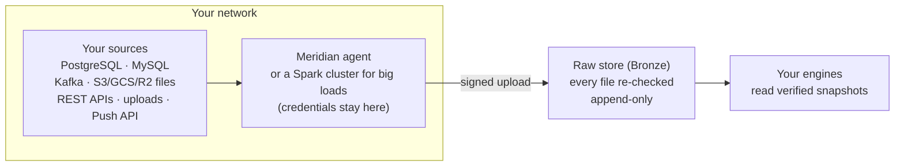

# Meridian Community, in plain terms

**Get your data in. Keep it exactly as it arrived.**

Meridian Community is an open-source data ingestion platform. It copies data out of your
databases, event streams, files and APIs into one raw, append-only store, checks every piece on
the way in, and lets your analytics tools read it safely. Your passwords and your network stay
yours.

[Download Preview 0.3](https://github.com/akmcypher/meredian/releases/tag/v0.3.0-preview) ·
[Full feature list](FEATURES.md) · Apache-2.0 · Windows, macOS and Linux

## How it works

1. **Connect.** Point Meridian at a database, topic, bucket or API from the web app; a step-by-step
   wizard tests the connection and lists the tables or topics to pick from.
2. **Read where the data lives.** A small agent runs inside your network, so the cloud never
   needs a way into it.
3. **Check and store.** Every batch is verified, then stored once and never changed.
4. **Use it anywhere.** Analytics engines read finished snapshots, with proof they got the right
   data.

## Sources

| Source                                                   | What it does for you                                                                                                                                                                                                                                                                |
| -------------------------------------------------------- | ----------------------------------------------------------------------------------------------------------------------------------------------------------------------------------------------------------------------------------------------------------------------------------- |
| PostgreSQL                                               | Copy whole tables, or only rows that changed since last time.                                                                                                                                                                                                                       |
| MySQL                                                    | The same full and incremental copies, with MySQL's own types handled exactly.                                                                                                                                                                                                       |
| Kafka                                                    | Stream events from topics, including JSON, Debezium change events and Avro.                                                                                                                                                                                                         |
| Cloud storage files                                      | CSV, TSV, JSON Lines and Parquet from AWS S3, Google Cloud Storage, MinIO or Cloudflare R2.                                                                                                                                                                                         |
| REST APIs                                                | Pull JSON from any HTTP endpoint straight from the web app.                                                                                                                                                                                                                         |
| Push and upload                                          | Let your apps post records with a per-source key, or drag in CSV, Parquet, Avro or JSON files.                                                                                                                                                                                      |
| **Spark versions** of PostgreSQL, MySQL, files and Kafka | When a table, bucket or topic is too large for one machine, the work is split across a cluster and read in parallel. Same results as the single-machine version, checked by tests on every change. Runs on a Spark cluster or on Kubernetes, with encrypted, authenticated traffic. |
| **Change data capture** for PostgreSQL and MySQL         | Every insert, update and delete, read from the database's own change log in the order it happened. Deleted rows are no longer missed.                                                                                                                                               |

## Built so data is never lost or counted twice

Moving data is easy until a machine crashes halfway. These mechanisms make a crash boring.

| Safeguard                        | How it works                                                                                                                | In plain terms                                                  |
| -------------------------------- | --------------------------------------------------------------------------------------------------------------------------- | --------------------------------------------------------------- |
| Resumes from the last save point | Every batch is saved with a bookmark of where reading stopped; a failed run picks up from there.                            | A game that autosaves after every level.                        |
| One worker per job               | Each piece of work is leased to one worker; a stalled worker's lease expires and its late writes are rejected.              | Two people can't check out the same library book.               |
| Every file checked on arrival    | Files written by Spark are re-read for size, checksum and row count before they count.                                      | The warehouse counts the boxes before signing for the delivery. |
| No silent gaps in Kafka          | If Kafka already deleted unread events, the run stops until the owner approves the exact gap, and the approval is recorded. | Missing pages get flagged, not skipped.                         |
| Bad records set aside            | Records that can't be decoded go to a dead-letter list you can fix and replay.                                              | Damaged parcels go to a returns shelf, not the bin.             |
| Raw data is never edited         | Batches are append-only; deletes and updates are recorded as new events.                                                    | A ledger, not a whiteboard.                                     |

## Parallel when the data gets big

Large tables are split by key, large files by byte range or Parquet row group, and Kafka topics
by partition and offset range. Spark executors each take a slice. The automated tests use:

- **300,002** CSV rows (about 16 MB) split into ranges across executors
- **200,007** Parquet rows read by row group in parallel
- **25,000** MySQL rows in hash partitions, matched row for row against one worker
- a **3-broker** Kafka cluster, with one broker stopped mid-read

These are test sizes on a local two-worker Spark cluster, not performance benchmarks.

## Production Kafka, including managed services

- **One task per partition:** several agents read one topic at once, with lag shown per partition.
- **Secured clusters:** SASL/SCRAM, SASL/PLAIN over TLS and mutual TLS; wrong credentials fail
  before anything is read.
- **One-line cloud setup:** profiles for Confluent Cloud, Azure Event Hubs, Amazon MSK (SCRAM and
  IAM), Redpanda Cloud and Aiven.
- **Backpressure:** reads stay within memory limits, and long runs stop at a set size or time and
  continue next run.
- **Schema registry:** Confluent Avro with schema evolution; tombstones kept as delete events.

## Secure by default

- **Credentials stay with you:** database, Kafka and bucket passwords live on the agent host,
  never in the cloud or the browser.
- **Access rules in the database:** row-level security scopes every row to its owner and
  organization.
- **Keys stored as hashes:** Push API keys are stored only as SHA-256 hashes.
- **Tamper-evident audit:** admin actions go to an append-only, hash-chained log you can verify.
- **Signed downloads:** release files are signed with Sigstore and carry build provenance.

## Running locally in two commands

Start Docker, download the package for your system from the
[release](https://github.com/akmcypher/meredian/releases/tag/v0.3.0-preview), and run these in the
extracted folder. The launcher fetches pinned, hash-checked tools for you.

| System                       | Commands                                             |
| ---------------------------- | ---------------------------------------------------- |
| Windows 11 (x64, ARM64)      | `.\meridian.cmd install` then `.\meridian.cmd start` |
| macOS (Apple silicon, Intel) | `./meridian install` then `./meridian start`         |
| Ubuntu / Debian (x64, ARM64) | `./meridian install` then `./meridian start`         |

Developers can build their own connector with the Connect SDK and its conformance test kit; see
the [connector developer guide](CONNECTOR_DEVELOPER_GUIDE.md).

## The jargon, decoded

| Term            | Meaning                                                                                             |
| --------------- | --------------------------------------------------------------------------------------------------- |
| Ingestion       | Copying data from the systems that create it into one place where it can be analysed.               |
| Bronze          | The first, raw layer of a data platform: data exactly as it arrived, before any cleaning.           |
| Incremental     | Copying only what changed since the last run instead of the whole table again.                      |
| Kafka partition | A topic is split into partitions so many readers can work in parallel; each keeps its own position. |
| Spark executor  | One of the worker processes in a Spark cluster; more executors read more data at once.              |
| Dead letter     | A record that couldn't be read, kept aside so it can be fixed and replayed.                         |
| CDC             | Change data capture: reading a database's change log, including deletes.                            |

## Where it stands

Preview 0.3 is pre-release software for evaluation and feedback. Everything here runs on local
machines and is covered by automated tests. It is not hosted or production-certified yet.

- PostgreSQL and MySQL CDC are tested on local databases only, not on managed cloud databases.
- Spark on Kubernetes and encrypted Spark traffic are tested on a local cluster only, not on a
  hosted one.
- Cloud-storage files support full refresh only.
- Managed Kafka profiles are tested offline and against a local secured broker, not against the
  hosted services.

Full details are in the [release notes](RELEASE_NOTES.md).
